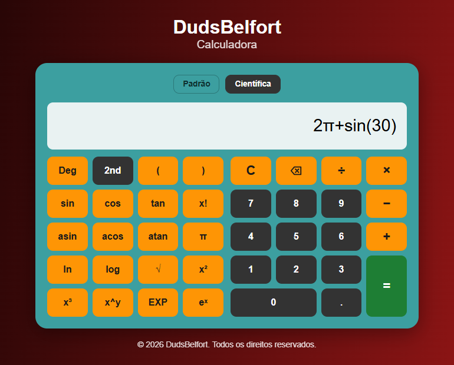
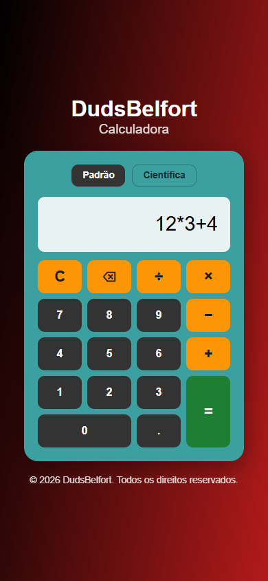

# Calculadora DudsBelfort

Calculadora web feita com HTML, CSS e JavaScript puro, com modo padrão e modo científico. Não precisa de instalação nem de dependências.

  
  &nbsp;
  

## Como usar

Abra o arquivo `calculadora.html` no navegador. Use os botões **Padrão** e **Científica** no topo da calculadora para trocar de modo.

## Funcionalidades

**Modo padrão:** soma, subtração, multiplicação, divisão, decimal, apagar (⌫) e limpar (C).

**Modo científico:**

| Tecla | Função |
| --- | --- |
| `sin` `cos` `tan` | Trigonometria (em graus ou radianos, alternando em **Deg/Rad**) |
| `asin` `acos` `atan` | Trigonometria inversa |
| `2nd` | Troca `sin`/`cos`/`tan` por `sinh`/`cosh`/`tanh` |
| `ln` `log` | Logaritmo natural e na base 10 |
| `√` `x²` `x³` `x^y` | Raiz quadrada e potências |
| `eˣ` `EXP` | Exponencial e notação científica (`2E3` = 2000) |
| `x!` `π` `(` `)` | Fatorial, pi e parênteses |

**Comportamentos do visor:**

- Multiplicação implícita: `2π`, `2(3)` e `2sin(30)` funcionam sem o `×`.
- Menos unário segue a regra da matemática: `-2^2` dá -4, `(-2)^2` dá 4.
- Resultados com até 12 algarismos significativos (`0.1+0.2` dá 0.3).
- Depois do `=`, um número começa uma conta nova e um operador continua a conta.
- Expressões inválidas (divisão por zero, `tan(90°)`) mostram **Erro**.

## Estrutura

| Arquivo | Conteúdo |
| --- | --- |
| `calculadora.html` | Página e teclados |
| `script.js` | Lógica: montagem e cálculo das expressões |
| `estilo.css` | Cores, botões, visor e página |
| `estilo_cientifica.css` | Layout dos dois modos e versão para celular |
| `img/` | Favicon e capturas de tela |

## Autor

Feito por [DudsBelfort](https://github.com/EduBelfort06).
